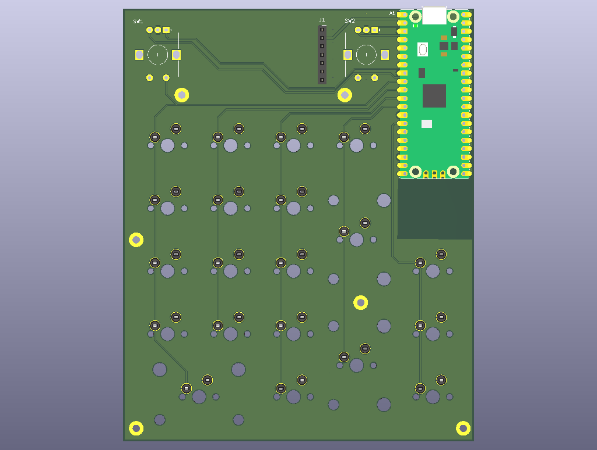
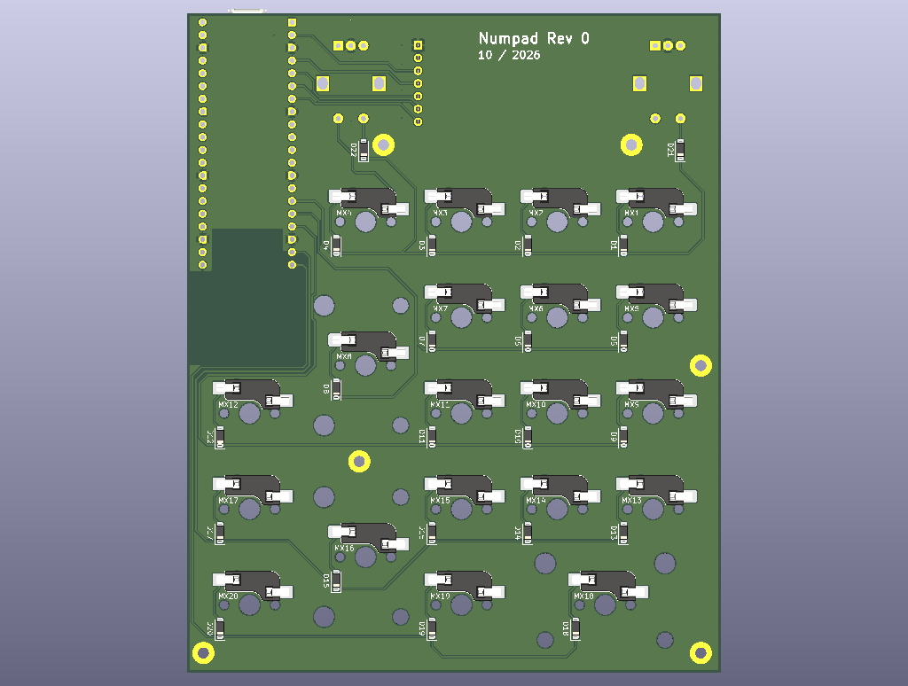

# PicoNumpad

Pico-based DIY numpad.

| Front | Back |
|---|---|
|  |  |

## Features

- Raspberry Pi Pico
- 17-key numpad layout
- 3 extra keys
- 2 rotary encoders
- LCD display

## Repository structure

```
pcb/          KiCad project (schematic and PCB)
pcb-layout/   FreeCAD layout model and exported board outline
```

### pcb-layout

A simple, parametric FreeCAD model of the numpad (PCB, keys, display,
Pico and encoders as basic boxes). It serves as a placement reference:
the board outline is exported as DXF and imported into KiCad as
`Edge.Cuts`, and the component positions are taken from the model.

## Tools

- KiCad
- FreeCAD

## Status

Work in progress. QMK Firmware and Case model will follow.

## License

See [LICENSE](LICENSE).
